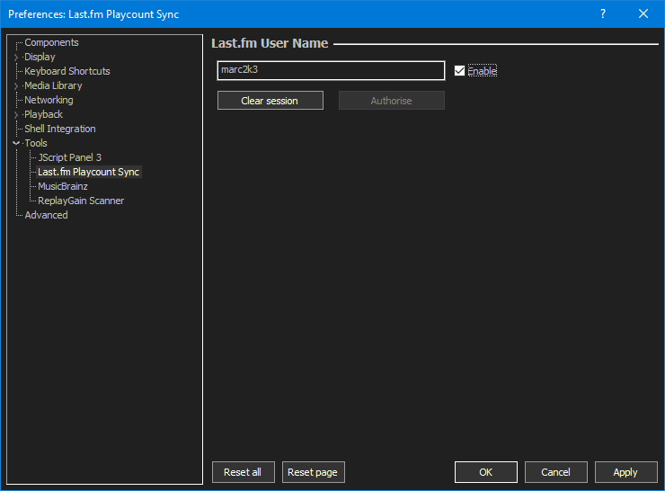
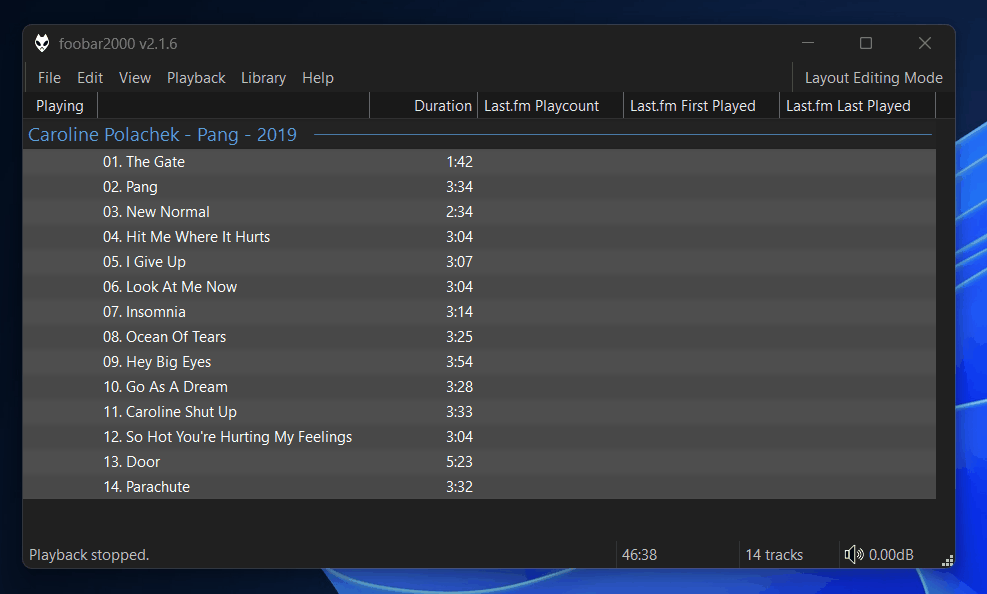

# Last.fm Playcount Sync
> [!IMPORTANT]
> In their infinite wisdsom, [Last.fm][] are going to put API access behind a paywall
> and I'm simply not buying in. Especially as that API key cannot be kept private.
>
> Therefore, if anyone wants to continue using this, they will have to compile it
> themselves using their own PRO API key and secret. See the [build instructions](BUILDING.md).

## Requirements
- `foobar2000` `2.25` or later. 32bit and 64bit are both supported.
- `Windows 10` or later.

## Overview
This component fetches [Last.fm][] playcounts and first played/last played dates
as you listen. A database is used to store the data so your files are not
touched.

This does not scrobble so you'll need another component for that.

Additionally, you can also love/unlove tracks. This requires [authorisation](#authorisation).

> [!NOTE]
> All lookups / storage are based on `$lower($meta(artist,0) - %title%)` with
> no consideration for album tags. This generally means the numbers will match
> anything you see on [Last.fm][] track pages/charts but you won't get the
> album stats you get from diving deeper in to your [Last.fm][] `Library`.

## Usage
Open `File>Preferences>Tools>Last.fm Playcount Sync` and enter your [Last.fm][] username.

### Authorisation
> [!NOTE]
> Using default [Last.fm][] privacy settings, you don't need to
> authorise your account for fetching playcount data.
>
> If you prefer, you can update your privacy settings to
> `Hide recent listening information`. This requires
> authorisation.
>
> You also need to authorise your account if you want to love
> or unlove tracks.

To start, click the `Authorise` button. This will launch a browser window
opening the [Last.fm][] website and you must grant
permission for this application **BEFORE** clicking the confirmation
dialog that opened at the same time as your browser.

When `Authorisation` is complete, you should receive final confirmation. If
you revoke permission or change your password on [Last.fm][],
you'll need to use the `Clear session` button and `Authorise` again.

### Updating playcounts
Simply listen and it will update in real time. A lookup is performed a
few seconds after playback starts and assuming the server response is
valid, all existing values for that track will be overwritten
by [Last.fm][] data. Server values always take precedence!

When you've listened to enough of a track for a count to scrobble, the
playcount is incremented by one and the last played date is set. This is
the only time data is written without contacting [Last.fm][]
because most scrobblers won't submit until after the track has finished.

If you can't wait to listen your tracks normally, you can batch import
up to 100 tracks at a time... just like this.

### Available fields

You can configure custom playlist colums or anything else that supports
title formatting to display the following:

|Field||
|---|---|
|`%lfm_playcount%`||
|`%lfm_first_played%`|`YYYY-MM-DD HH:MM:SS`|
|`%lfm_last_played%`|`YYYY-MM-DD HH:MM:SS`|
|`%lfm_first_played_ts%`|Unix timestamp|
|`%lfm_last_played_ts%`|Unix timestamp|
|`%lfm_now%`|`YYYY-MM-DD HH:MM:SS`|
|`%lfm_now_ts%`|Unix timestamp|
|`%lfm_first_played_ago%`||
|`%lfm_last_played_ago%`||

### Loving / unloving tracks
You can `Love` or `Unlove` by right clicking a track (or selection up to 20 tracks)
and using the appropriate menu item. You may consider binding buttons
or keyboard shortcuts.

Note that values are only updated on a successful response from [Last.fm][].

|Field||
|---|---|
|`%lfm_loved%`|Set to `1` if a track is loved. The field will be missing if not.|

### Importing loved tracks
Use the main menu `Library>Last.fm Playcount Sync>Import Last.fm loved tracks`.
Matches will be made against tracks that are monitored as part of the
`Media Library`. Check the `Console` for full results.

### Importing / exporting data
From the main menu `Library>Last.fm Playcount Sync`, you can import/export as
`JSON` for easy transfer to another install or just for backup purposes.

### Errors
Any `Authorisation` errors are reported by popup dialogs. Any errors
updating playcounts, importing loved tracks or loving/unloving tracks
are reported in the `Console`.

[Last.fm]: https://last.fm
